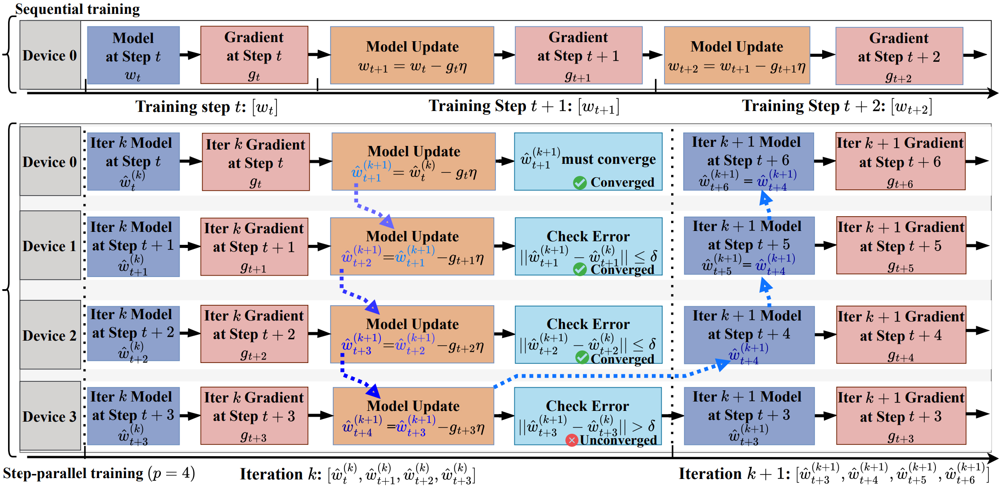
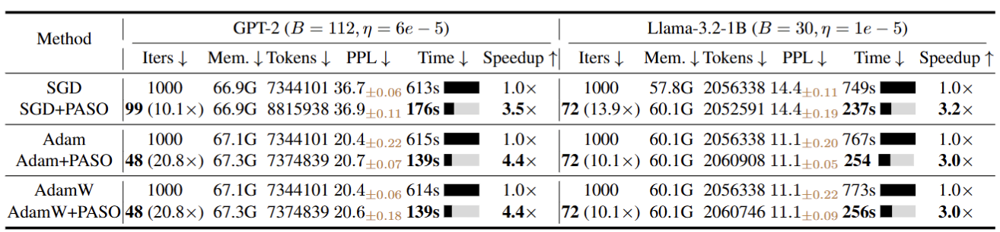

<p align="center">
  <h1 align="center">PASO: Step Parallel Stochastic Optimization</h1>

  <p align="center">
    <br />
    <strong>Anonymous Repository</strong></a>
  </p>
</p>


Official implementation of "PASO: Step Parallel Stochastic Optimization" 


# PASO Introdction

**PASO** is **the first step-parallel training framework** that breaks the sequential dependency of gradient descent without sacrificing model quality. By recasting training as a system of triangular nonlinear equations, PASO enables simultaneous gradient computation across multiple steps.

### 🌀 Workflow Overview
The following diagram illustrates how PASO parallelizes the traditionally sequential training steps:

<!--  -->



### 📈 Experimental Results
Quantitative comparisons of different methods on WiKiText-2, where models are initialized from pre-trained weights. The best results are highlighted in bold. $\uparrow$ (resp. $\downarrow$) means the larger (resp. smaller), the better. We define tokens as totally consumed tokens by the model. Memory (Mem.) refers to the peak GPU memory allocated during training. We report the mean and standard deviation across 5 runs.
 

## 🛠️ Environment & Installation

All experiments were conducted on a single node with **8 NVIDIA A100 GPUs (80GB)**, utilizing NVLink for high-speed inter-GPU communication.

* **OS:** Ubuntu 22.04
* **Software:** Python 3.10, PyTorch 2.5.1, CUDA 12.1, NCCL 2.21.5

```bash
pip install -r requirements.txt

```

## 📊 Reproducibility Mapping

The following table maps the scripts to the specific results presented in the paper.

| Result | Task | Script | Table/Figure in Paper |
| --- | --- | --- | --- |
| **Synthetic Benchmarks** | Sphere, Ackley, Rosenbrock | `optex_cmp.py` | Table 15 in Appendix G |
| **LLM (GPT-2)** | WikiText-2 | `llm.py` | Table 2 |
| **LLM (Llama-3.2-1B)** | WikiText-2 | `llm.py` | Table 2 / Fig. 3 |
| **Image Classification** | CIFAR-10 (ResNet50/ViT) | `cv.py` | Table 3 / Fig. 3 |
| **Diffusion Training** | LSUN Church (UNet) | `diffusion.py` | Table 4 |
| **FID Evaluation** | Diffusion Sampling | `sweep_fid.py` | Table 4 |

---

## ⚡ Quick Start: Reproducing Results

### 1. Verification (OptEx vs. PASO)  (Table 15 in Appendix G)

This script compares PASO against the OptEx baseline on synthetic functions (Sphere, Ackley, Rosenbrock) to demonstrate superior speedup and convergence.

```bash
python optex_cmp.py
```

### 2. Image Classification (CIFAR-10)

#### A. ResNet50 (Table 3)

Run sequential baselines and PASO-accelerated versions using the exact parameters from the paper.

```bash
# Serial Adam Baseline
python cv.py --dataset cifar10 --model_name resnet50 --max_steps 100000 --batch_size 2048 --learning_rate 0.00005 --threshold 0.1 --ema_decay 0.999 --training_mode serial --P 7 --optimizer_type adam --lr_scheduler_type cosine --warmup_steps 10000
# Serial AdamW Baseline
python cv.py --dataset cifar10 --model_name resnet50 --max_steps 100000 --batch_size 2048 --learning_rate 0.00005 --threshold 0.1 --ema_decay 0.999 --training_mode serial --P 7 --optimizer_type adamw --lr_scheduler_type cosine --warmup_steps 10000
# Serial SGD Baseline
python cv.py --dataset cifar10 --model_name resnet50 --max_steps 100000 --batch_size 2048 --learning_rate 0.00005 --threshold 0.1 --ema_decay 0.999 --training_mode serial --P 7 --optimizer_type sgd --lr_scheduler_type cosine --warmup_steps 10000

# Parallel Adam (PASO)
python cv.py --dataset cifar10 --model_name resnet50 --max_steps 100000 --batch_size 2048 --learning_rate 0.00005 --threshold 0.1 --ema_decay 0.999 --training_mode parallel --P 7 --optimizer_type adam --lr_scheduler_type cosine --warmup_steps 10000
# Parallel AdamW (PASO)
python cv.py --dataset cifar10 --model_name resnet50 --max_steps 100000 --batch_size 2048 --learning_rate 0.00005 --threshold 0.1 --ema_decay 0.999 --training_mode parallel --P 7 --optimizer_type adamw --lr_scheduler_type cosine --warmup_steps 10000
# Parallel SGD (PASO)
python cv.py --dataset cifar10 --model_name resnet50 --max_steps 100000 --batch_size 2048 --learning_rate 0.00005 --threshold 0.1 --ema_decay 0.999 --training_mode parallel --P 7 --optimizer_type sgd --lr_scheduler_type cosine --warmup_steps 10000

```

#### B. Vision Transformer (ViT) (Table 3)

```bash
# Serial Adam Baseline
python cv.py --dataset cifar10 --model_name resnet50 --max_steps 100000 --batch_size 2048 --learning_rate 0.00005 --threshold 0.1 --ema_decay 0.999 --training_mode serial --P 7 --optimizer_type adam --lr_scheduler_type cosine --warmup_steps 10000
# Serial AdamW Baseline
python cv.py --dataset cifar10 --model_name resnet50 --max_steps 100000 --batch_size 2048 --learning_rate 0.00005 --threshold 0.1 --ema_decay 0.999 --training_mode serial --P 7 --optimizer_type adamw --lr_scheduler_type cosine --warmup_steps 10000
# Serial SGD Baseline
python cv.py --dataset cifar10 --model_name resnet50 --max_steps 100000 --batch_size 2048 --learning_rate 0.00005 --threshold 0.1 --ema_decay 0.999 --training_mode serial --P 7 --optimizer_type sgd --lr_scheduler_type cosine --warmup_steps 10000

# Parallel Adam (PASO)
python cv.py --dataset cifar10 --model_name resnet50 --max_steps 100000 --batch_size 2048 --learning_rate 0.00005 --threshold 0.1 --ema_decay 0.999 --training_mode parallel --P 7 --optimizer_type adam --lr_scheduler_type cosine --warmup_steps 10000
# Parallel AdamW (PASO)
python cv.py --dataset cifar10 --model_name resnet50 --max_steps 100000 --batch_size 2048 --learning_rate 0.00005 --threshold 0.1 --ema_decay 0.999 --training_mode parallel --P 7 --optimizer_type adamw --lr_scheduler_type cosine --warmup_steps 10000
# Parallel SGD (PASO)
python cv.py --dataset cifar10 --model_name resnet50 --max_steps 100000 --batch_size 2048 --learning_rate 0.00005 --threshold 0.1 --ema_decay 0.999 --training_mode parallel --P 7 --optimizer_type sgd --lr_scheduler_type cosine --warmup_steps 10000
```

#### C. Memory-Efficient Distributed Version

Utilizes NCCL for optimized cross-GPU weight synchronization. 

```bash
torchrun --nproc_per_node=8 --master_port=12345 cv_nccl.py
```

---

### 3. LLM Tasks (WikiText-2)

#### A. GPT-2 Training (Table 2 & 5)

Reproduce results for varying window sizes and batch sizes.

```bash
# Serial Adam/AdamW  Baseline
python llm.py  --local_model_dir ./gpt2 --modelscope_name "gpt2" --max_steps 1000 --batch_size 112 --learning_rate 6e-5 --threshold 0.1 --ema_decay 0.999 --training_mode serial --P 21 --optimizer_type adam/adamw --lr_scheduler_type constant
# Parallel Adam/AdamW (PASO)
python llm.py  --local_model_dir ./gpt2 --modelscope_name "gpt2" --max_steps 1000 --batch_size 112 --learning_rate 6e-5 --threshold 0.1 --ema_decay 0.999 --training_mode parallel --P 21 --optimizer_type adam/adamw --lr_scheduler_type constant

# Serial SGD Baseline
python llm.py --modelscope_name "gpt2" --max_steps 1000 --batch_size 112 --learning_rate 6e-5 --threshold 1e-7 --ema_decay 0.9 --training_mode parallel --P 12 --optimizer_type sgd --lr_scheduler_type constant
# Parallel Adam (PASO)
python llm.py --modelscope_name "gpt2" --max_steps 1000 --batch_size 112 --learning_rate 6e-5 --threshold 1e-7 --ema_decay 0.9 --training_mode parallel --P 12 --optimizer_type sgd --lr_scheduler_type constant
```

#### B. Llama-3.2-1B Training (Table 2)

```bash
# Parallel AdamW/Adam/SGD (PASO)
python llm.py --local_model_dir "./Llama-3.2-1B" --modelscope_name "Llama-3.2-1B" --max_steps 1000 --batch_size 30 --learning_rate 1e-5 --threshold 0.1 --ema_decay 0.999 --training_mode parallel --P 14 --optimizer_type adamw --lr_scheduler_type cosine
python llm.py --local_model_dir "./Llama-3.2-1B" --modelscope_name "Llama-3.2-1B" --max_steps 1000 --batch_size 30 --learning_rate 1e-5 --threshold 0.1 --ema_decay 0.999 --training_mode parallel --P 14 --optimizer_type adam --lr_scheduler_type cosine
python llm.py --local_model_dir "./Llama-3.2-1B" --modelscope_name "Llama-3.2-1B" --max_steps 1000 --batch_size 30 --learning_rate 1e-5 --threshold 0.1 --ema_decay 0.999 --training_mode parallel --P 14 --optimizer_type sgd --lr_scheduler_type cosine


# Serial AdamW/Adam/SGD Baseline
python llm.py --local_model_dir "./Llama-3.2-1B" --modelscope_name "Llama-3.2-1B" --max_steps 1000 --batch_size 30 --learning_rate 1e-5 --threshold 0.1 --ema_decay 0.999 --training_mode serial --P 14 --optimizer_type adamw --lr_scheduler_type cosine
python llm.py --local_model_dir "./Llama-3.2-1B" --modelscope_name "Llama-3.2-1B" --max_steps 1000 --batch_size 30 --learning_rate 1e-5 --threshold 0.1 --ema_decay 0.999 --training_mode serial --P 14 --optimizer_type adam --lr_scheduler_type cosine
python llm.py --local_model_dir "./Llama-3.2-1B" --modelscope_name "Llama-3.2-1B" --max_steps 1000 --batch_size 30 --learning_rate 1e-5 --threshold 0.1 --ema_decay 0.999 --training_mode serial --P 14 --optimizer_type sgd --lr_scheduler_type cosine
```


#### C. Impact of Window Size $p$

```bash
# Parallel AdamW (PASO)
python llm.py  --local_model_dir "./gpt2" --modelscope_name "gpt2" --max_steps 1000 --batch_size 112 --learning_rate 6e-5 --threshold 0.1 --ema_decay 0.999 --training_mode parallel --P 21 --optimizer_type adamw --lr_scheduler_type constant
python llm.py  --local_model_dir "./gpt2" --modelscope_name "gpt2" --max_steps 1000 --batch_size 112 --learning_rate 6e-5 --threshold 0.1 --ema_decay 0.999 --training_mode parallel --P 17 --optimizer_type adamw --lr_scheduler_type constant
python llm.py  --local_model_dir "./gpt2" --modelscope_name "gpt2" --max_steps 1000 --batch_size 112 --learning_rate 6e-5 --threshold 0.1 --ema_decay 0.999 --training_mode parallel --P 14 --optimizer_type adamw --lr_scheduler_type constant
python llm.py  --local_model_dir "./gpt2" --modelscope_name "gpt2" --max_steps 1000 --batch_size 112 --learning_rate 6e-5 --threshold 0.1 --ema_decay 0.999 --training_mode parallel --P 10 --optimizer_type adamw --lr_scheduler_type constant
python llm.py  --local_model_dir "./gpt2" --modelscope_name "gpt2" --max_steps 1000 --batch_size 112 --learning_rate 6e-5 --threshold 0.1 --ema_decay 0.999 --training_mode parallel --P 7 --optimizer_type adamw --lr_scheduler_type constant
# Serial AdamW Baseline
python llm.py  --local_model_dir "./gpt2" --modelscope_name "gpt2" --max_steps 1000 --batch_size 112 --learning_rate 6e-5 --threshold 0.1 --ema_decay 0.999 --training_mode serial --P 21 --optimizer_type adamw --lr_scheduler_type constant
python llm.py  --local_model_dir "./gpt2" --modelscope_name "gpt2" --max_steps 1000 --batch_size 112 --learning_rate 6e-5 --threshold 0.1 --ema_decay 0.999 --training_mode serial --P 17 --optimizer_type adamw --lr_scheduler_type constant
python llm.py  --local_model_dir "./gpt2" --modelscope_name "gpt2" --max_steps 1000 --batch_size 112 --learning_rate 6e-5 --threshold 0.1 --ema_decay 0.999 --training_mode serial --P 14 --optimizer_type adamw --lr_scheduler_type constant
python llm.py  --local_model_dir "./gpt2" --modelscope_name "gpt2" --max_steps 1000 --batch_size 112 --learning_rate 6e-5 --threshold 0.1 --ema_decay 0.999 --training_mode serial --P 10 --optimizer_type adamw --lr_scheduler_type constant
python llm.py  --local_model_dir "./gpt2" --modelscope_name "gpt2" --max_steps 1000 --batch_size 112 --learning_rate 6e-5 --threshold 0.1 --ema_decay 0.999 --training_mode serial --P 7 --optimizer_type adamw --lr_scheduler_type constant
```

#### D. Impact of Batch Size $B$

```bash
# Parallel AdamW (PASO)
python llm.py  --local_model_dir "./gpt2" --modelscope_name "gpt2" --max_steps 1000 --batch_size 112 --learning_rate 6e-5 --threshold 0.1 --ema_decay 0.999 --training_mode parallel --P 21 --optimizer_type adamw --lr_scheduler_type constant
python llm.py  --local_model_dir "./gpt2" --modelscope_name "gpt2" --max_steps 1000 --batch_size 92 --learning_rate 6e-5 --threshold 0.1 --ema_decay 0.999 --training_mode parallel --P 21 --optimizer_type adamw --lr_scheduler_type constant
python llm.py  --local_model_dir "./gpt2" --modelscope_name "gpt2" --max_steps 1000 --batch_size 72 --learning_rate 6e-5 --threshold 0.1 --ema_decay 0.999 --training_mode parallel --P 21 --optimizer_type adamw --lr_scheduler_type constant
python llm.py  --local_model_dir "./gpt2" --modelscope_name "gpt2" --max_steps 1000 --batch_size 52 --learning_rate 6e-5 --threshold 0.1 --ema_decay 0.999 --training_mode parallel --P 21 --optimizer_type adamw --lr_scheduler_type constant
# Serial AdamW Baseline
python llm.py  --local_model_dir "./gpt2" --modelscope_name "gpt2" --max_steps 1000 --batch_size 112 --learning_rate 6e-5 --threshold 0.1 --ema_decay 0.999 --training_mode serial --P 25 --optimizer_type adamw --lr_scheduler_type constant
python llm.py  --local_model_dir "./gpt2" --modelscope_name "gpt2" --max_steps 1000 --batch_size 92 --learning_rate 6e-5 --threshold 0.1 --ema_decay 0.999 --training_mode serial --P 25 --optimizer_type adamw --lr_scheduler_type constant
python llm.py  --local_model_dir "./gpt2" --modelscope_name "gpt2" --max_steps 1000 --batch_size 72 --learning_rate 6e-5 --threshold 0.1 --ema_decay 0.999 --training_mode serial --P 25 --optimizer_type adamw --lr_scheduler_type constant
python llm.py  --local_model_dir "./gpt2" --modelscope_name "gpt2" --max_steps 1000 --batch_size 52 --learning_rate 6e-5 --threshold 0.1 --ema_decay 0.999 --training_mode serial --P 25 --optimizer_type adamw --lr_scheduler_type constant
```

#### E. Data-parallelism Comparision (Table 6)

Comparison against PyTorch DDP and DeepSpeed ZeRO-3.

```bash
# Adam Baseline
python llm.py  --local_model_dir "./gpt2" --modelscope_name "gpt2" --max_steps 1000 --batch_size 112 --learning_rate 6e-5 --training_mode serial --optimizer_type adam --lr_scheduler_type constant
# Step Parallelism w/o Optimization (PASO)
python llm.py  --local_model_dir "./gpt2" --modelscope_name "gpt2" --max_steps 1000 --batch_size 112 --learning_rate 6e-5 --threshold 0.1 --ema_decay 0.999 --training_mode parallel --P 21 --optimizer_type adam --lr_scheduler_type constant
# Data Parallelism w/o Optimization
python llm.py  --local_model_dir "./gpt2" --modelscope_name "gpt2" --max_steps 1000 --batch_size 112 --learning_rate 6e-5  --training_mode naive_dp --optimizer_type adam --lr_scheduler_type constant
# Data Parallelism w/ Full Optimization (Pytorch's DDP)
python llm.py  --local_model_dir "./gpt2" --modelscope_name "gpt2" --max_steps 1000 --batch_size 112 --learning_rate 6e-5  --training_mode ddp --optimizer_type adam --lr_scheduler_type constant
# Data Parallelism w/ Full Optimization (DeepSpeed)
deepspeed --num_gpus=8 llm.py  --local_model_dir "./gpt2" --modelscope_name "gpt2" --max_steps 1000 --batch_size 112 --learning_rate 6e-5  --training_mode deepspeed --optimizer_type adam --lr_scheduler_type constant --stage 3
```

---

### 4. Diffusion Models (LSUN Church)

#### A. UNet Training (Table 4)

```bash
# Serial Training (Adam Baseline)
python diffusion.py --results_folder diffusion_v2_serial --dataset lsun_church --model_name unet --training_mode serial --lr_scheduler_type cosine --warmup_steps 10000 --save_and_sample_every 10000

# Parallel Training (Adam + PASO)
python diffusion.py --results_folder diffusion_v2_parallel --dataset lsun_church --model_name unet --threshold 0.000001 --paso_ema_decay 0.99 --training_mode parallel --P 7 --lr_scheduler_type cosine --warmup_steps 10000 --save_and_sample_every 10000
```

#### B. FID Evaluation

Generate 50k samples and calculate the Fréchet Inception Distance.

```bash
# Parallel Mode FID Calculation
python sweep_fid.py --results_folder ./PASO/diffusion_v2_parallel --data_folder ./dataset/church_outdoor_images --milestones 10000 50000 100000 150000 200000 250000 300000 350000 400000 450000 500000 550000 600000 --csv_name parallel_fid.csv --batch_size 512 --num_samples 50000

# Serial Mode FID Calculation
python sweep_fid.py --results_folder ./PASO/diffusion_v2_serial --data_folder ./dataset/church_outdoor_images --milestones 10000 50000 100000 150000 200000 250000 300000 350000 400000 450000 500000 550000 600000 --csv_name serial_fid.csv --batch_size 512 --num_samples 50000
```

---

## 📈 Visualization

Use the provided script to compare the accuracy, loss, FID, and perplerxity curves between serial and PASO methods.

```bash
python plot_compare.py --column_name Val_Acc --type acc_ites --x_interval 10000 --y_interval 20 --y_min 0.0 --csv_path1 /patah/to/serial_results.csv --csv_path2 /patah/to/parallel_results.csv
```

For example, to plot the accuracy curve w.r.t iteration:

```bash
python plot_compare.py --column_name Val_Acc --type acc_ites --x_interval 10000 --y_interval 20 --y_min 0.0  ./PASO_standard/2025_12_12_1_04/cifar10/vit/steps_100000_bs_2048_lr_0.00015_optim_adamw_sched_cosine_warmup_10000_dropout_0.0/serial.csv ./PASO_standard/2025_12_12_1_04/cifar10/vit/steps_100000_bs_2048_lr_0.00015_optim_adamw_sched_cosine_warmup_10000_dropout_0.0/parallel_median_P_7_tor_0.1_ema_0.999.csv 
```


